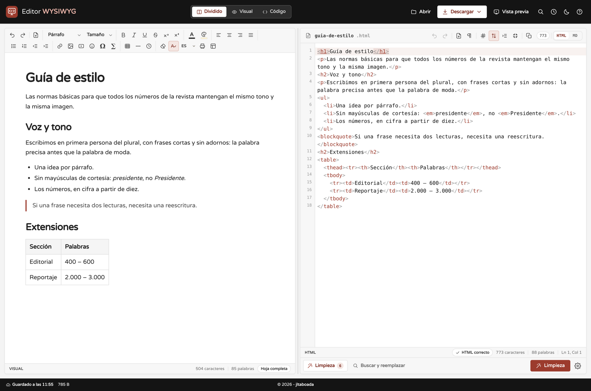

# Textos para la presentación del proyecto

Estos son los textos para la ficha del proyecto en tu web personal. Están en esta carpeta:

- `README.md` (este archivo): los textos en Markdown.
- `presentacion.html`: los mismos textos en HTML, listos para pegar.
- `img/`: las capturas de pantalla del editor, en PNG y WebP.

Dos piezas listas para pegar en tu web: una descripción corta para la ficha del listado y una
descripción larga para la página del proyecto. Al final hay una ficha técnica opcional y unas notas
que no van en la web.

---

## 1. Descripción breve (para el listado de proyectos)

Editor WYSIWYG de HTML y Markdown que funciona entero en el navegador: vista visual y código
sincronizados, limpieza de HTML, historial de versiones y exportación a HTML, Markdown, PDF o
Word. Sin cuentas, sin servidores y sin subir nada.

### Alternativas, según el espacio que tengas

**Una línea (para tarjetas muy estrechas):**

Editor de HTML y Markdown en el navegador, con vista visual y código sincronizados.

**La más personal (si el listado admite algo de voz propia):**

El editor HTML y Markdown que me hice porque estaba cansado de las limitaciones de los que había:
sin cuentas, sin anuncios y con todo el código a la vista.

**Para meta descripción o redes (unos 155 caracteres):**

Editor HTML y Markdown 100 % en el navegador: panel visual y código sincronizados, ecuaciones,
limpieza de HTML, historial y exportación a PDF, Word, Markdown o HTML.

---

## 2. Descripción detallada (página del proyecto)

<!-- Captura de pantalla del editor en funcionamiento. Alt sugerido:
     «Editor WYSIWYG con el panel visual y el panel de código HTML sincronizados». -->

### Un editor de HTML y Markdown que no te pone límites

**Editor WYSIWYG** es un editor de HTML y Markdown que funciona íntegramente en el navegador. No hay
servidor, no hay cuentas y no hay instalación: abres la página, escribes y descargas tu documento.
Todo lo que haces se queda en tu equipo.

#### Por qué lo hice

Llevo años usando editores HTML en línea y siempre acababa igual: peleándome con la herramienta en
lugar de escribiendo.

- Unos te obligan a registrarte para poder descargar tu propio documento.
- Otros te devuelven un HTML imposible de leer, lleno de `<span>` con estilos y clases heredadas de
  Word.
- Casi ninguno mantiene el panel de código en sincronía real con lo que ves: cambias una palabra
  arriba y el código de abajo se queda como estaba.
- Si quieres escribir en Markdown, o no puedes, o pierdes todos los estilos al volver a HTML.
- Y muchos cargan anuncios, analítica y rastreadores en una página que, en teoría, solo sirve para
  escribir texto.

Estaba cansado de esas limitaciones, así que decidí hacerme mi propio editor: uno que hiciera bien
lo que yo necesitaba y que no me obligara a nada. Este proyecto es el resultado.

#### El corazón: HTML y Markdown, sin perder nada

Lo que más me importaba era que el panel visual y el panel de código fueran **el mismo documento**,
no dos vistas que se parecen.

- **Sincronización real en los dos sentidos.** Escribes en el panel visual y el código se actualiza
  en milisegundos; editas el código y el documento cambia al momento. Cada modo conserva su propio
  historial de deshacer y su posición del cursor.
- **Código siempre ordenado.** No hace falta pulsar «formatear»: lo que llega al panel de código ya
  viene indentado, y al pegar HTML también se ordena solo. Si comprimes el documento, se respeta
  hasta que vuelvas a editarlo.
- **Dos lenguajes, un documento.** El conmutador HTML | MD convierte el documento en Markdown y de
  vuelta. Con **HTML incrustado** activado, todo lo que Markdown no sabe representar (colores,
  tipografías, vídeos, fórmulas, tablas complejas) viaja dentro del Markdown y no se pierde; al
  desactivarlo obtienes Markdown estándar y limpio. También hay notas al pie y listas de tareas con
  casillas que se marcan en el panel visual.
- **Una vista previa que funciona de verdad.** Los enlaces se pueden pulsar, el CSS y las tablas se
  aplican, los vídeos y los formularios responden, y puedes alternar entre el ancho de escritorio y
  el de móvil. Los scripts siguen desactivados mientras editas, y solo se ejecutan si abres el
  documento en una pestaña nueva.
- **Ecuaciones en LaTeX sin dependencias.** Se escriben con el botón ∑ y se guardan como MathML: el
  HTML exportado muestra las fórmulas sin cargar ninguna librería.

#### Lo que no suele encontrarse en otros editores

- **Formato de página real.** A4, Carta, Legal y A5, en vertical u horizontal, con márgenes
  normales, estrechos, amplios, sin márgenes o personalizados en milímetros. La hoja del editor, la
  vista previa, el PDF y el HTML descargado usan ese mismo formato.
- **Revisión de HTML en vivo.** Mientras escribes, el editor avisa de etiquetas sin cerrar, cierres
  que no corresponden, atributos repetidos o en mayúsculas, `id` duplicados, imágenes sin `alt`… y
  cada aviso te lleva a la línea y la columna exactas.
- **Historial de versiones.** Guarda una versión cada 1, 2, 5, 10, 15 o 30 minutos (o solo cuando tú
  quieras), hasta 30, y puedes restaurar cualquiera de ellas con confirmación y deshacerlo con
  `Ctrl`+`Z`.
- **Limpieza de HTML en 11 reglas.** Estilos inline, clases, identificadores, etiquetas vacías,
  comentarios, atributos sobrantes, espacios repetidos, scripts… Pensada para el HTML que llega
  pegado de otras herramientas.
- **Tablas e imágenes editables de verdad.** Con el cursor dentro de una tabla aparece una barra
  para añadir o quitar filas y columnas; al seleccionar una imagen aparece un tirador para cambiar
  su tamaño manteniendo la proporción.
- **Paleta de comandos con `Ctrl`+`K`.** Las 49 acciones del editor en un buscador que ignora los
  acentos: escribe «tabla», «oscuro», «margenes» o «pdf» y pulsa `Enter`.
- **Todo local y sin compilar.** No hay servidor, ni cuentas, ni anuncios, ni rastreadores. Las
  librerías viajan dentro del proyecto, así que funciona incluso abriendo `index.html` con doble
  clic, sin conexión y sin instalar nada.

#### Todo lo demás

Además de lo anterior, el editor incluye limpiador y buscador con expresiones regulares (hasta 10
reglas guardadas), corrección ortográfica con selección de idioma, modo claro y oscuro, modo
enfoque (`F11`), impresión sin encabezados ni pies de página, y exportación a HTML, Markdown, PDF,
ZIP con las imágenes incrustadas y Word (`.docx`), además de importación de `.html`, `.md`, `.docx`
y `.txt`. Para escribir hay 1.898 emoticonos con buscador en español, 300 caracteres especiales en
siete categorías, inserción de vídeo de YouTube, Vimeo y Dailymotion, líneas horizontales, fecha y
hora en seis formatos y texto de relleno. Y el borrador se guarda solo: al cerrar y volver, siguen
ahí el documento, el nombre, la vista, la división de los paneles, el tema y hasta el idioma del
corrector.

#### Es para todo el mundo

Puedes usarlo ahora mismo, sin registrarte, en **https://jltaboada.github.io/wysiwyg/**.

Y el código está en GitHub, en **https://github.com/jltaboada/wysiwyg**. Cualquiera puede clonarlo,
estudiarlo y modificarlo a su gusto:

```sh
git clone https://github.com/jltaboada/wysiwyg.git
```

Es una web estática, así que no hace falta compilar, ni instalar dependencias, ni montar un
servidor: se abre la carpeta y funciona. Si quieres tu propia copia en línea, puedes publicarla en
GitHub Pages, Netlify, Vercel, Cloudflare Pages o cualquier servidor, sin cambiar una línea.

Si encuentras un fallo, se te ocurre una mejora o quieres contar cómo lo usas, abre una *issue* en
el repositorio. Lo hice para mí, pero si a ti te sirve, mejor todavía.

---

## 3. Ficha técnica (opcional, para el pie de la página)

| | |
| --- | --- |
| **Tipo** | Editor WYSIWYG de HTML y Markdown, 100 % en el navegador |
| **Estado** | En desarrollo activo |
| **Demo** | https://jltaboada.github.io/wysiwyg/ |
| **Código** | https://github.com/jltaboada/wysiwyg |
| **Tecnología** | HTML, CSS y JavaScript sin frameworks, sin proceso de compilación |
| **Librerías** | CodeMirror, KaTeX, marked, Turndown, Mammoth, JSZip y js-beautify, incluidas en el repositorio |
| **Datos** | Nada se envía a ningún servidor: el documento y las preferencias se guardan en el navegador |
| **Publicación** | Cualquier alojamiento estático (GitHub Pages, Netlify, Vercel, un servidor propio) |

---

## Capturas de pantalla incluidas

Todas están hechas con la app real, a 1600 × 1060 y sin datos personales. Están en
`docs/presentacion/img/`.

| Archivo | Contenido | Tamaño |
| --- | --- | --- |
| `img/captura-editor-wysiwyg.png` | Modo dividido, tema claro. Es la recomendada para abrir la página | 1800 × 1193, 372 KB |
| `img/captura-editor-wysiwyg.webp` | La misma, en WebP (misma calidad, un tercio del peso) | 1800 × 1193, 116 KB |
| `img/captura-editor-wysiwyg-oscuro.png` | La misma escena en modo oscuro, por si quieres alternarlas | 1800 × 1193, 426 KB |
| `img/captura-editor-claro.png`, `img/captura-editor-oscuro.png` | Originales a doble resolución (3200 × 2120) para pantallas Retina | 444 KB cada una |

Si tu web sirve WebP, usa `captura-editor-wysiwyg.webp` y deja el PNG como respaldo:

```html
<picture>
  <source srcset="img/captura-editor-wysiwyg.webp" type="image/webp">
  
</picture>
```

---

## Notas para ti (esto no va en la web)

- **El enlace correcto es `/wysiwyg/`.** El repositorio se ha renombrado a `jltaboada/wysiwyg`, así
  que la demo es https://jltaboada.github.io/wysiwyg/ y el clonado, `…/wysiwyg.git`. Ya he
  actualizado el README con las dos direcciones, porque seguía apuntando a `/html-editor/`.
- **Copia de seguridad**: la captura va antes del título o justo después; si la pones al principio,
  deja que sea el primer elemento visual de la página y ponle el `alt` descriptivo de arriba.
- **Licencia**: el repositorio no tiene archivo `LICENSE`, así que, legalmente, el código es «todos
  los derechos reservados»: se puede ver y clonar, pero no reutilizarlo con seguridad. Si quieres que
  «cualquiera pueda usarlo» de verdad, añade una licencia permisiva (MIT o Apache 2.0). Si quieres,
  te la preparo.
- **Descripción del repositorio en GitHub**: ahora dice «Editor HTML online…», de cuando el proyecto
  era solo HTML. Te propongo esta, más ajustada: «Editor WYSIWYG de HTML y Markdown que funciona en
  el navegador, con vista visual y código sincronizados, ecuaciones, historial de versiones y
  exportación a HTML, Markdown, PDF y Word».
- **Temas del repositorio**: valdría la pena añadir `markdown-editor`, `wysiwyg-editor` y `no-build`
  (ya tiene `html-editor`, `wysiwyg`, `vanilla-js`, `codemirror` y `docx`). Ayudan a que el proyecto
  aparezca en búsquedas.
- Los textos evitan comparaciones absolutas del tipo «el único» o «el mejor»: hablan de lo que el
  editor hace y de lo que no es habitual encontrar junto. Suena más creíble y no da pie a
  discusiones.
